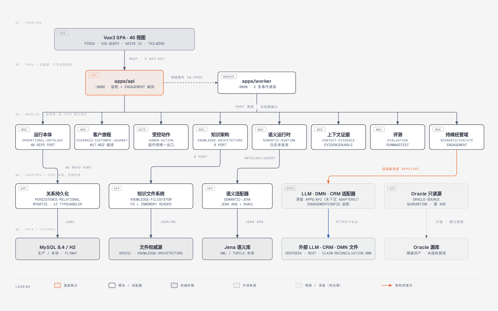

# GITS — 知识工程体系与智能体基础能力建设（gits-cbanking）

杭州银行「知识工程体系和智能体基础能力建设项目」工程仓库。面向**对公客户经理持续经营**业务闭环，构建**可编译语义合同 + 运行本体控制平面 + 多种可重建投影**的智能体基座。

- **合同 SSOT**：所有 API/事件/语义/规则/动作合同统一由 `specs/CONTRACT_INDEX.yaml` 登记（64 项），代码生成与实现不得越界；
- **领域优先、框架后置**：`modules/` 承载纯业务逻辑，仅以 Port 接口对外；`apps/` 只做装配，不写业务规则；
- **受控副作用**：AI 只能产生候选 Claim/Proposal，正式 Action 必经人工确认、权限复核、幂等、原值校验与回执（`human-action` 模块是唯一出口）；
- **与 KERT 的关系**：KERT 是独立知识工程服务端，GITS 仅经其公共 HTTP（`:8106`）调用；闸门推进与交互记忆持久化的权威在 GITS。

## 系统架构（2026-10-12）

内部六边形分层（Port/Adapter）全景；自包含 HTML/SVG 源见 `diagrams/gits-internal-hexagonal.html`：



更多视图（GITS+KERT 全景拓扑 / KERT 内部分层 / 集成安全铺装路）见 `diagrams/*.html`；V1.1 基线架构说明见 `diagrams/ARCHITECTURE.md`。

## 当前状态

- **V1.1 已验收**（2026-08）：M17→M22 客户旅程主链、HumanGate/CRM 写回/审计追踪/证据版本全部落地；
- **GK-KE 全程序完成**（L0-2→L6，12 个 Loop，QA_PASS `qa-gkl6-001`）：`/gk-ke/v1` 15 个 operation + 21 项知识工程合同，全部 `CONTRACT_CANDIDATE / simulation_only`，未激活生产；
- **当前推进**：PI-ARCH 产品目录/产品中心（前端 V8 导航、提案族/产品族/分析族视图）、UAT1–UAT3 独立 QA_PASS；
- `PRODUCTION_READY=NO`；真实外部系统（CRM/Oracle/LLM 生产凭据）按 ADR 受控启用，Oracle 源默认 quarantine。

## 技术栈

| 层 | 技术 |
|---|---|
| 后端 | Java 21 · Spring Boot 3.5.16 · Spring Modulith 1.4.12 · MyBatis 3.0.4 · Apache Jena 6.2.0 · Flyway |
| 前端 | Vue 3.5 · Vite · Pinia · vue-query · Naive UI（主）/ TDesign（辅） · Tailwind · ECharts（Node ≥ 22） |
| 数据 | MySQL 8.4（生产）/ H2 内存（本地，MySQL 兼容模式）· Jena 语义库 · 文件权威源（`specs/`） |
| 集成 | KERT（HTTP `:8106`）· LLM（可插拔，失败降级模板/正则）· DMN（claim-reconciliation）· CloudEvents 1.0 |
| 可观测 | Micrometer + Prometheus · Zipkin · Logstash JSON · Actuator |

## 分层结构

```text
frontend/（Vue3 SPA，46 视图）
  └─ apps/api :8080（装配 + engagement 编排）   apps/worker :8090（2 条领域事件通道）
       └─ modules/ ×7 + scenario/execute（仅 Port 接口对外，模块间禁止依赖实现类）
            └─ adapters/ ×4（persistence-relational / semantic-jena / knowledge-filesystem / oracle-source[隔离]）
                 └─ MySQL/H2 · Jena · 文件权威源 · Oracle 源库（默认禁用）
```

注意：LLM / DMN / CRM 适配器当前滞留在 `apps/api/.../adapter/`，未下沉 `adapters/`（架构债，见架构图橙色标注）。

## 合同治理（API First）

1. 合同源先行 → 2. `make generate`（只读制品）→ 3. `make check`（哈希比对）→ 4. 写实现。
- 合同登记：`specs/CONTRACT_INDEX.yaml`（64 项：json_schema ×46、openapi ×4、openapi_paths ×5、asyncapi、turtle ×2、linkml、dmn 等）；
- `generated/` 只读，禁止手工修改；新增 Port/合同须同步登记；兼容性四级（见 WI-02 决策）。

## 快速开始

```bash
make bootstrap-check      # 严格检查 Java 21 / Maven Wrapper / Node 22+ / Python 3.11+ / ripgrep
make generate             # 从合同权威源生成只读制品
make check                # 全部门禁（完整性 + 就绪度）
make backend-test         # Java 真实编译 + 测试（H2 内存库，无需本地 MySQL）
make frontend-test        # 前端锁文件安装 + vue-tsc + Vitest + 构建

# 端到端业务链演示（王磊/鑫达贸易，M17→M22）
./scripts/e2e-demo.sh           # H2 默认；./scripts/e2e-demo.sh mysql 走 MySQL

# 前端开发（Vite 代理 /api → localhost:8080）
cd frontend && npm run dev
```

完整本地验证：`make verify`（含 framework-test / tooling-test / db-check / semantic-rule-gate / 判据审计 / 索引门禁）。

## 测试

| 侧 | 规模 | 框架 |
|---|---|---|
| 后端 | 147 个 `*Test` + 15 个 `*IT` | JUnit 5 · AssertJ · Mockito · `@SpringBootTest` + H2 · JaCoCo 行覆盖 ≥ 80% |
| 前端 | 74 个 spec 文件 | Vitest · @vue/test-utils · happy-dom · vue-tsc --noEmit · Playwright（E2E） |

纪律：红测先记 `FAILURES.md`/ITER 再修复；开发自检只能写 `DEV_SELF_CHECK_PASS`，`QA_PASS` 仅独立 QA 角色可记。

## 部署

- **Dockerfile**（两阶段，temurin-21）：`apps/api` 镜像 `EXPOSE 8080`；Worker 复用同镜像以 `SERVER_PORT=8090` 区分；
- **compose.local.yaml**：api :8080 · worker :8090 · nginx（前端）:80 · mysql:8.4 `127.0.0.1:3306`；
- **docker-compose.prod.yaml**：追加 zipkin :9411 · prometheus :9090 · grafana :3000，全部回环绑定；`API_KEY` + CORS 强制，LLM/CRM/Oracle 凭据走环境变量。

## 目录

| 目录 | 责任 |
|---|---|
| `specs/` | 合同权威源、基线索引（SSOT） |
| `generated/` | 自动生成制品（只读，禁止手改） |
| `apps/` | API 启动应用 + 独立 Worker（仅装配） |
| `modules/` | 7 个领域模块：运行本体 / 客户旅程 / 受控动作 / 知识架构 / 语义运行时 / 上下文证据 / 评测 |
| `scenario/` | 场景域聚合（execute 持续经营域 + seed 演示数据 + kert-platform 预留骨架） |
| `adapters/` | 4 个适配器（Port 实现，对接外部） |
| `frontend/` | Vue3 岗位工作台（46 视图） |
| `diagrams/` | 架构图（HTML/SVG/PNG） |
| `docs/` | 设计文档（`architecture/` ADR、`dispatch/` 派工、`governance/` 治理） |
| `loops/` | Loop 批次状态、证据、Baton 交接 |
| `tools/quarantine/` | 未授权默认禁用的隔离资产 |

## 文档索引

| 文档 | 说明 |
|---|---|
| [AGENTS.md](AGENTS.md) | 仓库代理规则入口（合同 SSOT、角色边界、证据纪律） |
| [AI_GUIDE.md](AI_GUIDE.md) | AI 协作指引 |
| `specs/CONTRACT_INDEX.yaml` | 唯一合同注册表 |
| [diagrams/ARCHITECTURE.md](diagrams/ARCHITECTURE.md) | V1.1 基线架构说明（分层/ADR/合同精选） |
| `docs/architecture/ADR_INDEX.md` | 架构决策记录索引 |
| `docs/governance/MODULE_CATALOG.md` | 22 模块身份、范围与阶段 |
| `docs/governance/CODE-FACT-INDEX-PROCESS.md` | 代码事实索引流程（GOV-CFI-001） |

## 证据纪律

- `make generate` 只从合同权威源生成；`make check` 重新编译到临时目录比对哈希；
- 任何红测先进入 `FAILURES.md`/ITER，再修复；
- 真实 E2E 必须由独立角色在真实环境留存命令、日志、截图或回执证据；
- 未落盘结论 = 不存在（Loop 共享记忆规则）；禁止使用 `git add .`。
