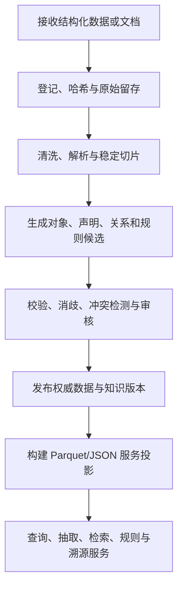
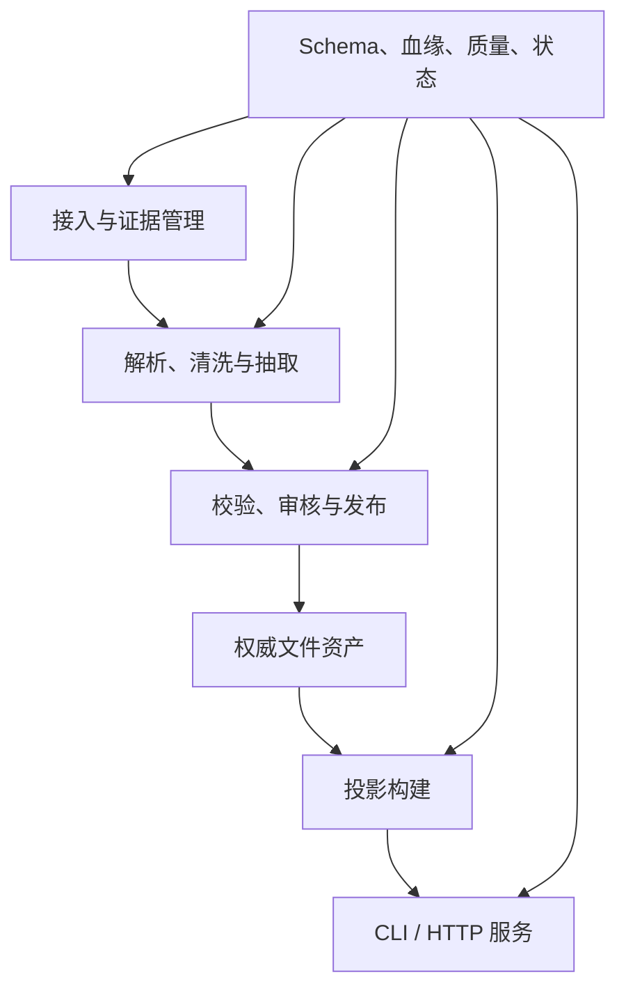
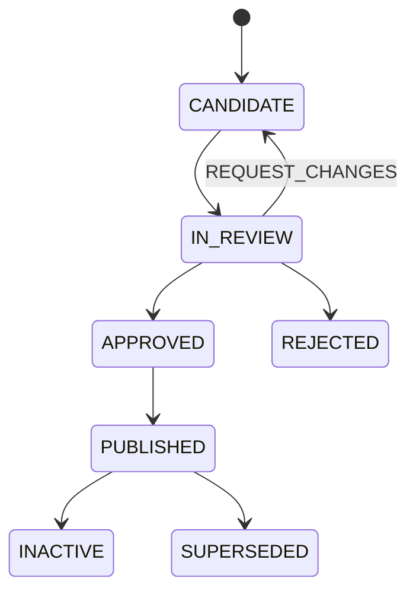

# 文件目录型数据知识服务模拟平台｜详细需求与详细设计 V1.0

| 控制项 | 值 |
|---|---|
| 文档编号 | `DKWS-SPEC-001` |
| 文档版本 | `V1.0` |
| 文档状态 | `DRAFT_CANDIDATE` |
| 目标实现 | 普通文件目录上的数据与知识服务模拟平台 |
| 权威存储 | 文件系统，不使用数据库 |
| 权威知识格式 | 契约化 Markdown |
| 批量结构化格式 | Parquet |
| 服务交换格式 | JSON |
| 原始运行日志 | UTF-8 文本 `.log` |
| 基线状态 | `NOT_BASELINED` |
| Owner 批准 | `NO` |
| 已实现 | `NO` |
| 已验收 | `NO` |
| 冻结 | `NO` |

> 本文是可供智能体开发工具或 Agent Harness 执行的软件需求与详细设计候选。文档完整不等于系统已经实现、测试通过、Owner 批准或形成正式基线。

---

## 1. 文档目的与执行合同

### 1.1 目的

建设一个不依赖数据库、消息队列、对象存储或分布式计算框架的模拟平台，在一个普通工作区目录内统一管理和服务：

- CSV、JSON、Parquet 等结构化数据输入；
- PDF、DOCX、HTML、TXT、图片等非结构化证据；
- 文档解析结果与稳定切片；
- 实体、关系、知识声明和规则；
- 文件化知识图谱、全文检索和向量检索投影；
- 数据集查询、知识抽取、图谱查询、规则判断、知识问答准备和证据溯源；
- 元数据、Schema、血缘、质量、流程状态、发布、回滚和审计证据。

平台首先用于架构验证、数据与知识合同验证、Agent/Harness 自动开发验证以及小规模演示，不把本设计描述为生产级数据中台或生产级知识平台。

### 1.2 设计角色与决策边界

本规格采用以下逻辑职责分离：

| 逻辑角色 | 职责 | 禁止事项 |
|---|---|---|
| Owner / Baseline Owner | 批准范围、状态、发布门禁和破坏性变更 | 不得用口头意见替代受控决策记录 |
| Requirements Lead | 管理需求、范围、验收标准和追踪关系 | 不得自行声明需求已批准 |
| Architecture Lead | 设计目录、文件合同、服务、状态机和控制机制 | 不得把设计完成写成已实现 |
| Knowledge Engineer | 解析、抽取、消歧、融合和知识候选管理 | 不得将模型候选直接发布为权威知识 |
| Operator | 执行接入、加工、发布、重建、回滚和检查 | 不得跳过门禁覆盖 `03_core` |
| Reviewer | 审核候选实体、关系、声明和规则 | 不得修改原始证据来消除冲突 |
| Service Consumer | 调用查询、抽取、检索、规则和溯源服务 | 不得直接修改工作区权威文件 |
| Independent QA | 检查可复现性、合同、追踪、测试和状态真实性 | 不得替作者静默修复缺陷后自签通过 |

### 1.3 权威输入优先级

发生冲突时按以下顺序裁决：

1. Owner 已批准的决策记录与范围基线；
2. 本规格的已批准版本；
3. 受控 Schema 和文件合同；
4. 已发布 `03_core` 权威资产；
5. `01_raw` 中带哈希的原始证据；
6. `02_work` 候选和中间结果；
7. `04_serve` 可重建投影；
8. 运行报告、日志和非受控说明。

`04_serve` 不得反向覆盖 `03_core`；`02_work` 不得直接成为正式服务事实；自然语言说明不得覆盖 Front Matter 中的机器状态字段。

### 1.4 本期范围

本期必须实现：

- 单工作区、单机文件系统；
- 默认单写者、多读者；
- 五个一级目录；
- 原始资产接入、哈希、批次和不可变保存；
- 结构化数据清洗和 Parquet 标准化；
- 文档解析、规范化和稳定切片；
- 实体、关系、声明、规则候选生成；
- 契约化 Markdown 校验、审核、发布和版本管理；
- 从权威 Markdown 生成 Parquet/JSON 服务投影；
- CLI 必选、HTTP API 可选；
- 数据查询、知识抽取、检索、图谱、规则、证据溯源；
- 质量门禁、血缘、任务状态、运行报告和回滚；
- 自动化测试、样例数据和端到端演示。

### 1.5 明确排除

本期不实现：

- MySQL、PostgreSQL、SQLite、Neo4j、Elasticsearch、Milvus 等任何持久化数据库；
- Kafka、RabbitMQ、Redis、Temporal 等基础设施；
- Hadoop、Spark、Flink、Kubernetes 等分布式平台；
- 多节点一致性和高可用；
- 复杂租户隔离和生产计费；
- 自动替代人工审批、合规判断或业务责任；
- 将大模型抽取置信度等同于事实真实性；
- 不经审核直接把抽取候选发布到权威知识层。

### 1.6 默认假设

- 目标运行环境支持 Python 3.11+ 或等价语言运行时；
- 文件系统支持原子重命名；
- 工作区规模以百万级以下结构化记录、万级以下知识 Markdown 文件为初始验证范围；
- 原始文件可包含敏感或不可信内容，解析器必须按不可信输入处理；
- 向量模型、OCR、LLM 可通过可插拔适配器调用，本规格不锁定供应商；
- 没有配置模型时，平台仍须通过确定性样例适配器完成端到端测试。

---

## 2. 核心原则与术语

### 2.1 五层原则

```text
01_raw      = 不可变的原始输入与证据
02_work     = 可删除、可重建的加工过程和候选
03_core     = 通过校验/审核的权威数据与知识
04_serve    = 从 03_core 可重建的服务投影与服务交换文件
90_control  = 全局目录、Schema、血缘、质量、任务、决策和日志
```

### 2.2 关键不变量

1. 原始证据不可被加工程序原地修改。
2. 任何 `03_core` 资产必须能追溯到原始证据、人工录入或受控决策。
3. 模型抽取结果初始状态必须为 `CANDIDATE`。
4. 未通过发布门禁的候选不得出现在正式服务的 `current` 投影中。
5. `04_serve` 必须可以仅凭 `03_core` 与受控配置重新生成。
6. 图谱只是权威对象、关系和声明的一种投影，不是唯一事实源。
7. 向量只是检索投影，不得成为不可追溯的权威知识。
8. 规则正文的自然语言说明不得参与确定性执行；执行只读取受控结构区。
9. 所有机器状态必须来自固定字段，不得从正文推断。
10. 发布、回滚和投影切换必须原子完成，失败时保留上一有效版本。
11. 同一业务 ID 与版本对应的内容必须具有稳定哈希。
12. 日志、报告或服务响应不得伪造 Owner 审批或测试通过状态。

### 2.3 术语

| 术语 | 定义 |
|---|---|
| 原始资产 | 未经平台语义改变的外部输入文件 |
| 证据 | 可支持、否定或限定知识声明的来源对象 |
| 文档 | PDF、DOCX、HTML、TXT、图片或其规范化表示 |
| 片段 Segment | 可稳定定位、引用和哈希的文档最小证据单元 |
| 实体 Entity | 具有稳定标识的业务对象或概念实例 |
| 关系 Relation | 两个实体之间的有向语义连接 |
| 声明 Statement | 对主体作出的可溯源事实、属性或判断表达 |
| 规则 Rule | 具有条件、动作、责任边界和版本的可执行或可检查约束 |
| 候选 Candidate | 尚未通过发布授权的抽取或加工结果 |
| 权威资产 Core Asset | 已通过规定门禁、可被正式服务消费的资产 |
| 投影 Projection | 从权威资产生成的图、向量、全文、规则运行或数据集形式 |
| 知识包 | 针对领域、岗位或场景组合的文档、实体、声明、关系和规则集合 |
| 契约化 Markdown | YAML Front Matter 加固定正文段落组成、可机器校验的 `.md` 文件 |

---

## 3. 用户旅程与用例

### 3.1 端到端主旅程



### 3.2 主要用例

| 用例ID | 参与者 | 目标 |
|---|---|---|
| `UC-001` | Operator | 初始化一个符合合同的空工作区 |
| `UC-002` | Operator | 接入结构化文件并生成不可变批次 |
| `UC-003` | Operator | 接入文档并生成原始证据登记 |
| `UC-004` | Knowledge Engineer | 解析文档、提取段落、表格和稳定片段 |
| `UC-005` | Knowledge Engineer | 生成实体、关系、声明和规则候选 |
| `UC-006` | Reviewer | 审核、驳回、修订或批准候选知识 |
| `UC-007` | Operator | 将批准资产发布到 `03_core` |
| `UC-008` | Operator | 从指定 Core 版本重建服务投影 |
| `UC-009` | Consumer | 查询结构化数据集和实体属性 |
| `UC-010` | Consumer | 进行全文、向量或混合知识检索 |
| `UC-011` | Consumer | 查询图谱邻居或限定路径 |
| `UC-012` | Consumer | 输入业务事实并执行规则判断 |
| `UC-013` | Consumer | 提交文档并获得 `CANDIDATE` 抽取结果 |
| `UC-014` | Consumer | 从结果追溯到文档、页码、片段和版本 |
| `UC-015` | QA | 验证哈希、Schema、血缘、门禁和可重建性 |
| `UC-016` | Operator | 将服务指针回滚到上一有效版本 |

---

## 4. 功能需求

### 4.1 工作区与目录管理

| ID | 需求 | 验收标准 |
|---|---|---|
| `FR-WS-001` | 系统必须通过单条命令初始化五个一级目录和最小控制文件。 | 在空目录执行后，结构检查返回 `PASS`。 |
| `FR-WS-002` | 系统必须拒绝使用目录外路径、`..` 路径穿越和未授权符号链接。 | 安全测试中的越界请求均被拒绝并记录。 |
| `FR-WS-003` | 系统必须支持按业务域组织资产，不以“结构化/非结构化”作为强制一级分类。 | 同一领域可同时包含 Parquet、原文和知识 MD。 |
| `FR-WS-004` | 系统必须区分受保护目录、可重建目录和服务交换目录。 | 删除 `02_work`/投影后可重建；未经发布命令不可写 `03_core`。 |
| `FR-WS-005` | 系统必须提供工作区一致性检查命令。 | 能检查目录、文件名、编码、Schema、引用、哈希和指针。 |

### 4.2 原始资产接入

| ID | 需求 | 验收标准 |
|---|---|---|
| `FR-ING-001` | 接入必须创建唯一批次 ID，并复制而非移动用户输入。 | 输入文件保留，Raw 中出现哈希一致的副本。 |
| `FR-ING-002` | 每批必须生成 `MANIFEST.md`，记录来源、文件、大小、媒体类型和 SHA-256。 | 清单可被解析且与实物重算一致。 |
| `FR-ING-003` | 同一幂等键和相同内容的重复接入不得产生语义重复批次。 | 重试返回原批次或明确 `NO_OP`。 |
| `FR-ING-004` | 同名不同内容必须生成新版本或冲突，不得静默覆盖。 | 原文件仍可访问，新内容具有独立哈希。 |
| `FR-ING-005` | 接入必须执行大小、扩展名、实际媒体类型和允许列表检查。 | 伪装扩展名和超限文件进入隔离或被拒绝。 |
| `FR-ING-006` | 原始文档中的宏、脚本和嵌入对象不得被执行。 | 安全样例不能触发宿主执行。 |

### 4.3 结构化数据加工

| ID | 需求 | 验收标准 |
|---|---|---|
| `FR-DATA-001` | 系统必须读取 CSV、JSON/JSONL 和 Parquet 输入，并将规范化批量结果写为 Parquet。 | 三类样例输入得到等价标准结果。 |
| `FR-DATA-002` | 每个数据集必须有字段、类型、可空性、主键、业务键和分区约定。 | Schema 校验能识别缺列、错型和重复主键。 |
| `FR-DATA-003` | 清洗不得丢弃错误记录；错误记录必须进入 `02_work/.../rejected/`。 | 输入数等于通过数加拒绝数。 |
| `FR-DATA-004` | 系统必须保留来源资产、批次、来源行号或来源记录 ID。 | 任意 Core 记录可以反查来源。 |
| `FR-DATA-005` | 系统必须支持全量快照和按业务日期/批次的增量分区。 | 样例可以重放并生成确定结果。 |

### 4.4 文档解析与切片

| ID | 需求 | 验收标准 |
|---|---|---|
| `FR-DOC-001` | 系统必须为每个文档创建 `DOCUMENT.md` 并关联原文件哈希。 | 文档记录与 Raw 原文件一一对应。 |
| `FR-DOC-002` | 解析结果必须保留标题层级、页码、段落顺序、表格和图片引用。 | 样例引用可回到正确页和结构位置。 |
| `FR-DOC-003` | 每个片段必须生成稳定 `segment_id` 和内容哈希。 | 对未变文档重复运行，片段 ID 与哈希不变。 |
| `FR-DOC-004` | 解析器不得把页眉页脚、OCR 噪声或模型补写静默混入原文。 | 清洗与推断内容具有明确标记。 |
| `FR-DOC-005` | 文档切片策略必须版本化。 | 切片策略变化会产生新 run/version，不覆盖旧结果。 |

### 4.5 知识候选生成与治理

| ID | 需求 | 验收标准 |
|---|---|---|
| `FR-KNW-001` | 系统必须支持实体、关系、声明和规则四类候选。 | 每类均有样例、Schema、校验器和测试。 |
| `FR-KNW-002` | 候选必须记录来源片段、抽取器、模型/提示词版本和置信度。 | 任意候选可追溯完整生成上下文。 |
| `FR-KNW-003` | 所有模型生成资产初始状态必须为 `CANDIDATE`。 | 直接生成 `APPROVED` 的测试必须失败。 |
| `FR-KNW-004` | 系统必须执行实体消歧、重复检测、悬空引用和冲突检测。 | 黄金样例能发现同名异体、重复和矛盾声明。 |
| `FR-KNW-005` | 驳回资产必须保留驳回原因，不得物理删除以掩盖历史。 | 审计可查看候选到驳回的完整链路。 |
| `FR-KNW-006` | 人工修订必须记录原候选、修改人、修改时间和理由。 | 修订前后哈希及决策记录可核对。 |

### 4.6 权威发布与版本

| ID | 需求 | 验收标准 |
|---|---|---|
| `FR-PUB-001` | 只有 `APPROVED` 且通过引用、Schema、证据和冲突门禁的资产可发布。 | 任一门禁失败则 Core 无变化。 |
| `FR-PUB-002` | 发布必须形成不可变版本目录和 `RELEASE.md`。 | 版本包含资产清单、哈希和发布决定。 |
| `FR-PUB-003` | `CURRENT.md` 指针切换必须原子完成。 | 故障注入时仍指向旧有效版本或完整新版本。 |
| `FR-PUB-004` | 系统必须支持撤销、失效和替代，不得通过删除掩盖历史。 | 历史版本及生失效时间仍可查询。 |
| `FR-PUB-005` | 系统必须支持回滚服务指针，但不得伪造 Core 历史。 | 回滚后服务恢复旧版本，Core 版本均保留。 |

### 4.7 投影与知识服务

| ID | 需求 | 验收标准 |
|---|---|---|
| `FR-SRV-001` | 系统必须从 Core MD 生成实体、关系、声明 Parquet 投影。 | 删除投影后重建，规范化哈希一致。 |
| `FR-SRV-002` | 系统必须生成文档片段、全文字段和可选向量 Parquet 投影。 | 检索结果包含片段 ID 和来源。 |
| `FR-SRV-003` | 系统必须提供结构化数据集过滤、选择、限制和导出。 | CLI/API 对样例查询返回正确结果。 |
| `FR-SRV-004` | 系统必须提供实体查找、邻居查询和有限深度路径查询。 | 查询结果与关系投影一致且无悬空节点。 |
| `FR-SRV-005` | 系统必须提供规则评估，并返回命中规则、输入事实、输出、证据和人工责任边界。 | 正向、反向和边界用例均通过。 |
| `FR-SRV-006` | 知识抽取服务必须返回候选，不得自动进入 Core。 | 抽取完成后 `publish_status=NOT_PUBLISHED`。 |
| `FR-SRV-007` | 所有知识结果必须支持证据溯源。 | 结果可定位文档、片段、页码、哈希和版本。 |
| `FR-SRV-008` | 正式服务只能读取活动的发布投影，不得扫描未批准 Work 候选。 | 注入候选不会改变正式查询结果。 |

### 4.8 控制、质量与审计

| ID | 需求 | 验收标准 |
|---|---|---|
| `FR-CTL-001` | 所有任务必须有 `STATUS.md`、原始日志和完成后的 `RUN_REPORT.md`。 | 成功和失败任务均可审计。 |
| `FR-CTL-002` | 状态必须由封闭枚举表示，不得从正文推断。 | 非法状态无法通过校验。 |
| `FR-CTL-003` | 血缘必须覆盖 Raw→Work→Core→Serve。 | 可从服务结果双向追踪到 Raw。 |
| `FR-CTL-004` | 质量规则和结果必须版本化并与任务绑定。 | 报告能说明执行了哪些规则及结果。 |
| `FR-CTL-005` | 系统必须提供全量验证与快速验证两种模式。 | 全量检查哈希和全引用，快速模式检查结构和变更集。 |
| `FR-CTL-006` | 所有破坏性或发布动作必须留下决策/执行证据。 | 审计能还原操作者、时间、输入和结果。 |

---

## 5. 非功能需求

| ID | 类别 | 要求与量化口径 |
|---|---|---|
| `NFR-001` | 可移植性 | Linux 必须支持；Windows/macOS 应支持。不得依赖 Unix 专有符号链接作为唯一指针机制。 |
| `NFR-002` | 确定性 | 相同输入、配置、代码和模型固定输出时，规范化输出哈希必须一致。 |
| `NFR-003` | 可恢复性 | Work/Serve 删除后可重建；任务中断重试不得破坏已发布版本。 |
| `NFR-004` | 可审计性 | 100% Core 资产具有来源或受控人工创建证据；100%发布具有 Release 记录。 |
| `NFR-005` | 性能 | 基线环境上，10 万行 Parquet 查询 P95≤2秒；1万实体一跳查询 P95≤1秒，具体基线须由实现记录。 |
| `NFR-006` | 容量 | 首版至少验证 100 万结构化记录、1万MD知识文件、10万关系和10万片段投影。 |
| `NFR-007` | 并发 | 默认单写者、多读者；至少支持 10 个并发只读请求，写冲突必须显式拒绝或排队。 |
| `NFR-008` | 安全 | 防路径穿越、符号链接逃逸、文件伪装、宏执行、压缩炸弹、提示词注入影响控制面。 |
| `NFR-009` | 隐私 | 日志默认不记录完整原文和敏感字段；支持字段脱敏和访问日志。 |
| `NFR-010` | 可观测性 | 每任务具有耗时、输入/输出/拒绝数、错误和警告统计。 |
| `NFR-011` | 可测试性 | 每类合同均有合法、非法、边界和回归样例。 |
| `NFR-012` | 兼容性 | 契约破坏性变更必须提升 major 版本；读取器至少兼容当前及上一 major。 |

---

## 6. 总体架构

### 6.1 逻辑架构



### 6.2 组件

| 组件 | 主要责任 | 输入 | 输出 |
|---|---|---|---|
| Workspace Manager | 初始化、路径和结构检查 | 配置、路径 | 工作区骨架 |
| Ingestor | 复制、哈希、媒体检查、批次登记 | 外部文件 | Raw 批次 |
| Tabular Processor | 清洗、类型化、拒绝隔离 | CSV/JSON/Parquet | Work/Core Parquet |
| Document Parser | OCR、版面、标题、表格、片段 | 文档 | 规范化MD与片段MD |
| Extractor Adapter | 抽取实体、关系、声明、规则 | 片段、Schema | 候选MD |
| Validator | 合同、引用、冲突、质量检查 | 候选/核心资产 | 结果与发现 |
| Review Manager | 审核、修订、批准、驳回 | 候选MD | 决策记录 |
| Publisher | 创建Core版本、Release和指针 | 批准资产 | Core发布版本 |
| Projection Builder | 生成Parquet/JSON运行投影 | Core版本 | Serve版本 |
| Query Service | 表格、实体、图谱、检索、溯源 | 服务投影 | JSON/Parquet结果 |
| Rule Engine | 确定性规则求值 | 规则投影、事实 | 判断与证据 |
| Job Controller | 锁、状态、日志、重试、报告 | 命令 | 任务证据 |

### 6.3 技术约束

- 允许使用 Apache Arrow/PyArrow 或等价 Parquet 库。
- 允许使用内存计算引擎读取 Parquet，但不得把其数据库文件作为持久化事实源。
- CLI 为强制接口；HTTP 层必须调用同一应用服务，不得复制业务逻辑。
- 所有适配器必须通过接口隔离，OCR、Embedding、LLM 可替换。
- 核心功能在没有外部网络和外部模型时仍可用固定样例完成测试。

---

## 7. 物理目录详细设计

```text
data-knowledge-workspace/
├── 01_raw/
│   └── <domain>/batch=<batch_id>/
├── 02_work/
│   └── <domain>/run=<run_id>/
├── 03_core/
│   └── <domain>/version=<release_version>/
├── 04_serve/
│   └── <service_id>/version=<projection_version>/
└── 90_control/
    ├── catalog/
    ├── schema/
    ├── lineage/
    ├── quality/
    ├── jobs/
    ├── decisions/
    ├── locks/
    └── logs/
```

### 7.1 `01_raw`

- 只允许接入组件创建新批次；禁止就地编辑。
- 每个批次必须包含 `MANIFEST.md`。
- 原始文档保留原扩展名；原始结构化文件可保留输入格式。
- 批次关闭后，清单中的内容哈希不得变化。

### 7.2 `02_work`

- 可以清理和重建，但必须保留任务状态和运行报告。
- 推荐子目录：`normalized/`、`segments/`、`candidates/`、`rejected/`、`metrics/`。
- 所有模型输出先进入这里。

### 7.3 `03_core`

- 只允许 Publisher 写入。
- 版本目录发布后不可变。
- 每个版本必须包含 `RELEASE.md` 与资产清单。
- 领域根目录使用 `CURRENT.md` 指向活动版本，不依赖符号链接。

### 7.4 `04_serve`

- 完全可重建，不是权威源。
- 每个服务版本含 `PROJECTION.md` 和投影文件。
- 服务根目录以 `CURRENT.md` 指向活动投影。
- `request/response/result` 仅用于模拟交换，不得混入权威资产。

### 7.5 `90_control`

- 保存跨领域目录、Schema、血缘、质量、任务、决策、锁和原始日志。
- `jobs/<job_id>/STATUS.md` 是该任务的机器状态权威文件。
- 原始执行日志采用 `.log`，完成后生成 `RUN_REPORT.md`。

---

## 8. 全局文件与命名规范

### 8.1 编码与换行

- 文本统一 UTF-8，无 BOM。
- 规范化换行统一 LF；读取器应容忍 CRLF。
- Markdown 正文使用 CommonMark/GFM 子集。
- 禁止使用依赖特定渲染器才能解释的隐藏语义。

### 8.2 路径和文件名

- 目录与机器生成文件名使用小写 `snake_case`；固定控制文件使用大写名称。
- 路径必须是工作区相对路径；Front Matter 禁止保存宿主绝对路径。
- 业务域：`^[a-z][a-z0-9_]{1,63}$`。
- ID：`^[A-Z][A-Z0-9_-]{2,127}$`。
- 禁止 `..`、控制字符、尾随空格和跨平台保留名称。

### 8.3 时间、日期和版本

- 时间戳统一 RFC 3339 UTC，例如 `2026-08-19T10:00:00Z`。
- 业务日期使用 `YYYY-MM-DD`。
- 合同 Schema 版本使用 `name/v<major>`，例如 `entity/v1`。
- 软件版本使用 SemVer。
- 领域发布版本推荐 `YYYY.MM.DD.N`，例如 `2026.08.19.1`。
- 同一版本目录内容发布后不得修改；修订必须创建新版本。

### 8.4 哈希

- 文件内容哈希使用 SHA-256，小写十六进制。
- Markdown 语义哈希必须基于规范化字节：UTF-8、LF、去除尾随空格、文件末尾单个换行。
- 自指哈希字段不得参与自身哈希；具体排除字段必须由 Schema 指定。
- Parquet 重建一致性比较采用逻辑规范化哈希：固定列序、固定行排序、统一空值和时间表达，不直接依赖二进制字节一致。

### 8.5 契约化 Markdown 通则

每个机器可读 Markdown 必须满足：

1. 文件第一个字符开始为 `---`；
2. 仅含一个 YAML Front Matter；
3. Front Matter 后必须有一个空行；
4. 正文第一个标题必须是一级标题；
5. `schema`、主 ID、`status`、`version` 为必填字段，除非本规范明确豁免；
6. YAML 禁止自定义标签、锚点、别名和多文档分隔；
7. 日期必须加引号或被解析为字符串，避免隐式类型差异；
8. 枚举大小写敏感；
9. 未声明字段默认拒绝，扩展字段必须以 `x_` 开头；
10. 机器逻辑只读取 Front Matter 和明确的受控代码块，不从叙述正文推断状态或规则。

### 8.6 空值和缺失

- 字段不存在表示“不适用或合同未定义”；
- YAML `null` 表示“已定义但当前无值”；
- 空字符串只表示真实空字符串，不得代替 null；
- `UNKNOWN` 是受控业务状态，不得与 null 混用；
- Parquet 对应字段使用原生 null。

### 8.7 原子写与锁

- 写入先在同目录创建临时文件，`fsync` 后原子重命名。
- 发布先完成新版本，再更新 `CURRENT.md`。
- 写任务必须持有 `90_control/locks/<scope>.lock`。
- 锁至少记录 job、owner、host、pid、acquired_at、expires_at。
- 过期锁只能由恢复命令在验证关联任务已终止后清理。

---

## 9. 逐类 Markdown 文件合同

本章定义权威 Markdown 文件。示例只展示最小合法内容；实现必须以字段表和 Schema 校验器为准。

### 9.1 原始批次清单 `MANIFEST.md`

**位置：** `01_raw/<domain>/batch=<batch_id>/MANIFEST.md`

**生成者：** Ingestor。**消费者：** Parser、Validator、QA。**可变性：** 批次关闭前可追加，关闭后不可变。

| 字段 | 类型 | 必填 | 约束 |
|---|---|---:|---|
| `schema` | string | 是 | 固定 `raw_manifest/v1` |
| `batch_id` | string | 是 | 全工作区唯一 |
| `domain` | string | 是 | 合法业务域 |
| `status` | enum | 是 | `OPEN/CLOSED/QUARANTINED` |
| `source_system` | string | 是 | 来源系统或 `MANUAL_UPLOAD` |
| `source_uri` | string/null | 否 | 只能保存脱敏逻辑标识，不得保存凭据 |
| `idempotency_key` | string | 是 | 同一业务请求稳定 |
| `received_at` | timestamp | 是 | UTC |
| `received_by` | string | 是 | 人或服务主体 |
| `files` | list | 是 | 至少一个文件 |
| `files[].path` | string | 是 | 批次内相对路径 |
| `files[].media_type` | string | 是 | 实际检测 MIME |
| `files[].size_bytes` | integer | 是 | `>=0` |
| `files[].sha256` | string | 是 | 64位小写十六进制 |
| `files[].role` | enum | 是 | `DATA/DOCUMENT/IMAGE/RULE/REFERENCE/OTHER` |
| `closed_at` | timestamp/null | 条件 | `CLOSED` 时必填 |

正文固定标题：`# 原始批次清单`、`## 来源说明`、`## 接入备注`。

```markdown
---
schema: raw_manifest/v1
batch_id: BATCH-20260819-001
domain: product
status: CLOSED
source_system: product_management
idempotency_key: product-20260819-001
received_at: "2026-08-19T10:00:00Z"
received_by: svc_ingestor
files:
  - path: product.parquet
    media_type: application/vnd.apache.parquet
    size_bytes: 10240
    sha256: 0000000000000000000000000000000000000000000000000000000000000000
    role: DATA
closed_at: "2026-08-19T10:00:02Z"
version: "1.0"
---

# 原始批次清单

## 来源说明

产品管理系统日快照。

## 接入备注

无。
```

校验失败时不得关闭批次；媒体伪装、哈希不一致或越界路径必须置为 `QUARANTINED`。

### 9.2 文档登记 `DOCUMENT.md`

**位置：** `02_work/<domain>/run=<run_id>/documents/<document_id>/DOCUMENT.md`；发布后复制规范化版本到 Core。

| 字段 | 类型 | 必填 | 约束 |
|---|---|---:|---|
| `schema` | string | 是 | `document/v1` |
| `document_id` | string | 是 | 稳定且唯一 |
| `title` | string | 是 | 非空 |
| `document_type` | enum | 是 | `POLICY/MANUAL/CONTRACT/REPORT/WEBPAGE/FORM/OTHER` |
| `language` | string | 是 | BCP 47，如 `zh-CN` |
| `source_batch_id` | string | 是 | Raw 批次 |
| `source_path` | string | 是 | 工作区相对路径 |
| `source_sha256` | string | 是 | 与 Raw 一致 |
| `source_media_type` | string | 是 | 实际 MIME |
| `business_owner` | string/null | 否 | 业务责任方 |
| `published_at` | timestamp/null | 否 | 原文发布日期 |
| `effective_from/to` | date/null | 否 | 效力区间 |
| `confidentiality` | enum | 是 | `PUBLIC/INTERNAL/CONFIDENTIAL/RESTRICTED` |
| `parse_status` | enum | 是 | `PENDING/PARSED/PARTIAL/FAILED` |
| `parser_id/version` | string/null | 条件 | 已解析时必填 |
| `page_count` | integer/null | 否 | 可用时记录 |
| `validation_status` | enum | 是 | `CANDIDATE/APPROVED/REJECTED` |
| `status` | enum | 是 | `ACTIVE/INACTIVE/SUPERSEDED` |
| `version` | string | 是 | 资产版本 |

正文固定标题：`# <文档标题>`、`## 文档摘要`、`## 来源与效力说明`、`## 解析说明`。摘要属于说明，不得替代原文证据。

### 9.3 规范化全文 `NORMALIZED.md`

**位置：** `02_work/<domain>/run=<run_id>/documents/<document_id>/NORMALIZED.md`

Front Matter 必填：`schema=normalized_document/v1`、`document_id`、`source_sha256`、`parser_id`、`parser_version`、`parse_run_id`、`normalization_policy_version`、`status`、`version`。

正文规则：

- 尽量保持原文标题层级；
- 每页边界使用 `<!-- page:12 -->`；
- 表格使用 GFM 表格或受控 HTML 转义文本，不得丢失单元格顺序；
- 图片使用 ``，并带 `<!-- figure:id -->`；
- OCR 不确定文本用 `[OCR_UNCERTAIN:原识别文本]`；
- 模型补写、摘要或推断禁止混入正文；
- 页眉页脚删除策略必须在 `normalization_policy_version` 中可追溯。

### 9.4 文档片段 `<segment_id>.md`

**位置：** `02_work/<domain>/run=<run_id>/segments/<document_id>/<segment_id>.md`

| 字段 | 类型 | 必填 | 约束 |
|---|---|---:|---|
| `schema` | string | 是 | `document_segment/v1` |
| `segment_id` | string | 是 | 稳定ID |
| `document_id` | string | 是 | 必须存在 |
| `segment_type` | enum | 是 | `TITLE/PARAGRAPH/CLAUSE/TABLE/FIGURE/CAPTION/LIST/OTHER` |
| `heading_path` | list[string] | 是 | 可为空列表，不可缺失 |
| `page_from/page_to` | integer/null | 否 | `page_to>=page_from` |
| `sequence` | integer | 是 | 文档内从1递增 |
| `char_start/end` | integer/null | 否 | 规范化全文位置 |
| `content_sha256` | string | 是 | 正文证据区的规范化哈希 |
| `chunk_policy_version` | string | 是 | 切片策略版本 |
| `parent_segment_id` | string/null | 否 | 层次片段父级 |
| `previous/next_segment_id` | string/null | 否 | 顺序导航 |
| `status` | enum | 是 | `ACTIVE/SUPERSEDED` |
| `version` | string | 是 | 版本 |

正文只允许：`# <片段标题>`、`## 原文`、可选 `## 解析注记`。`## 原文` 是证据哈希范围；注记不得参与内容哈希。

稳定ID推荐算法：

```text
segment_id = "SEG-" + upper(base32(sha256(
  document_id + "|" + heading_path_normalized + "|" +
  segment_type + "|" + normalized_content
))[0:20])
```

内容未变且标题路径未变时 ID 稳定；切片政策导致边界变化时创建新版本和 `supersedes` 关系。

### 9.5 实体 `<entity_id>.md`

**位置：** 候选在 `02_work/.../candidates/entities/`；权威版本在 `03_core/<domain>/version=.../entities/`。

| 字段 | 类型 | 必填 | 约束 |
|---|---|---:|---|
| `schema` | string | 是 | `entity/v1` |
| `entity_id` | string | 是 | 全局稳定ID |
| `entity_type` | string | 是 | 必须存在于类型目录 |
| `name` | string | 是 | 规范名称 |
| `aliases` | list[string] | 是 | 可为空，去重 |
| `description` | string/null | 否 | 简短定义 |
| `domain` | string | 是 | 业务域 |
| `source_ids` | list[string] | 是 | 至少一个来源或决策ID |
| `confidence` | number/null | 条件 | 模型候选为0到1；人工创建可为空 |
| `extraction` | map/null | 条件 | 模型候选必须有 extractor/model/prompt 版本 |
| `validation_status` | enum | 是 | `CANDIDATE/IN_REVIEW/APPROVED/REJECTED` |
| `status` | enum | 是 | `ACTIVE/INACTIVE/MERGED/SUPERSEDED` |
| `merged_into` | string/null | 条件 | `MERGED` 时必填 |
| `effective_from/to` | date/null | 否 | 业务效力 |
| `version` | string | 是 | 资产版本 |

正文固定：`# <name>`、`## 定义`、`## 业务说明`、`## 来源证据`、`## 审核说明`。属性事实原则上保存为 Statement，不在实体正文中堆叠不可验证属性。

### 9.6 关系 `<relation_id>.md`

| 字段 | 类型 | 必填 | 约束 |
|---|---|---:|---|
| `schema` | string | 是 | `relation/v1` |
| `relation_id` | string | 是 | 全局唯一 |
| `source_id` | string | 是 | 已存在实体 |
| `relation_type` | string | 是 | 必须存在于关系类型目录 |
| `target_id` | string | 是 | 已存在实体 |
| `direction` | enum | 是 | 固定 `DIRECTED`；对称性由类型定义 |
| `statement_id` | string/null | 否 | 佐证该关系的声明 |
| `source_ids` | list[string] | 是 | 至少一个证据/决策 |
| `confidence` | number/null | 条件 | 模型候选必填 |
| `validation_status` | enum | 是 | 候选生命周期 |
| `status` | enum | 是 | `ACTIVE/INACTIVE/SUPERSEDED` |
| `effective_from/to` | date/null | 否 | 关系效力 |
| `version` | string | 是 | 版本 |

正文固定：`# <关系说明>`、`## 语义`、`## 来源证据`、`## 审核说明`。校验器必须拒绝悬空实体、非法类型组合和被禁止的自环。

### 9.7 知识声明 `<statement_id>.md`

声明采用主体—谓词—客体/值模型；`object_id` 与 `object_value` 必须且只能有一个非空。

| 字段 | 类型 | 必填 | 约束 |
|---|---|---:|---|
| `schema` | string | 是 | `statement/v1` |
| `statement_id` | string | 是 | 全局唯一 |
| `subject_id` | string | 是 | 已存在实体 |
| `predicate` | string | 是 | 受控词汇 |
| `object_id` | string/null | 条件 | 对象引用 |
| `object_value` | scalar/null | 条件 | 字面值 |
| `value_type` | enum | 是 | `OBJECT_REF/STRING/INTEGER/DECIMAL/BOOLEAN/DATE/DATETIME/DURATION/CODE` |
| `unit` | string/null | 条件 | 数值需要时必填 |
| `source_type` | enum | 是 | `STRUCTURED_DATA/DOCUMENT/MANUAL/DERIVED` |
| `source_asset_id` | string | 是 | 数据集、文档或决策 |
| `source_record_id` | string/null | 条件 | 结构化来源建议必填 |
| `source_segment_id` | string/null | 条件 | 文档来源必须填 |
| `derivation_rule_id` | string/null | 条件 | `DERIVED` 必填 |
| `confidence` | number/null | 条件 | 模型候选必填 |
| `polarity` | enum | 是 | `AFFIRMED/NEGATED/UNCERTAIN` |
| `validation_status` | enum | 是 | 候选生命周期 |
| `conflict_status` | enum | 是 | `NONE/POTENTIAL/CONFIRMED/RESOLVED` |
| `effective_from/to` | date/null | 否 | 事实有效期 |
| `recorded_at` | timestamp | 是 | 记录时间 |
| `status` | enum | 是 | `ACTIVE/INACTIVE/SUPERSEDED` |
| `version` | string | 是 | 版本 |

正文固定：`# <自然语言声明>`、`## 规范表达`、`## 来源证据`、`## 冲突与限定`、`## 审核说明`。正文的自然语言不得覆盖结构化字段。

### 9.8 规则 `<rule_id>.md`

规则执行区位于 Front Matter 的 `when` 和 `then`；正文只解释业务意义与责任边界。

| 字段 | 类型 | 必填 | 约束 |
|---|---|---:|---|
| `schema` | string | 是 | `rule/v1` |
| `rule_id/name` | string | 是 | 稳定ID和名称 |
| `rule_type` | enum | 是 | `VALIDATION/ELIGIBILITY/CALCULATION/RECOMMENDATION/ROUTING/ALERT` |
| `priority` | integer | 是 | 0到1000，数值越大优先级越高 |
| `execution_mode` | enum | 是 | `AUTOMATIC/ADVISORY/HUMAN_CONFIRM_REQUIRED` |
| `when` | expression | 是 | 受限DSL |
| `then` | action map | 是 | 受限动作，不允许任意代码 |
| `else` | action map/null | 否 | 可选 |
| `required_inputs` | list | 是 | 字段与类型 |
| `source_document_id/segment_id` | string/null | 条件 | 文档规则必填 |
| `test_case_ids` | list[string] | 是 | 至少正向、反向各一个 |
| `validation_status` | enum | 是 | 候选生命周期 |
| `status` | enum | 是 | `ACTIVE/INACTIVE/SUPERSEDED` |
| `effective_from/to` | date/null | 否 | 规则有效期 |
| `version` | string | 是 | 版本 |

DSL 仅允许：

- 逻辑：`all`、`any`、`not`；
- 比较：`eq/ne/gt/gte/lt/lte/in/not_in/contains/starts_with/exists/is_null`；
- 值：字面量、输入字段引用和受控常量；
- 动作：设置结果字段、发出提示、列出要求、计算受控表达式；
- 禁止 shell、动态 import、网络访问、文件写入、反射和任意代码求值。

正文固定：`# <规则名>`、`## 业务解释`、`## 输入与输出`、`## 证据`、`## 人工责任边界`、`## 测试说明`。

### 9.9 资产目录 `<asset_id>.md`

**位置：** `90_control/catalog/<asset_id>.md`

必填字段：`schema=asset_catalog/v1`、`asset_id`、`asset_type`、`name`、`domain`、`owner`、`classification`、`authoritative_layer`、`current_version`、`location`、`upstream_ids`、`downstream_ids`、`status`、`version`。

`asset_type` 枚举：`DATASET/DOCUMENT_COLLECTION/ENTITY_SET/RELATION_SET/STATEMENT_SET/RULE_SET/KNOWLEDGE_PACK/SERVICE/PROJECTION`。

正文固定：`# <资产名>`、`## 业务定义`、`## 内容范围`、`## 上下游`、`## 使用限制`、`## 变更记录`。

### 9.10 Schema 合同 `<schema_name>.md`

**位置：** `90_control/schema/<schema_name>/v<major>/SCHEMA.md`

Schema 自身也是契约化 Markdown。Front Matter 至少包括：`schema=schema_contract/v1`、`schema_id`、`target_schema`、`major_version`、`compatibility`、`primary_id_field`、`required_fields`、`allowed_fields`、`enums`、`reference_fields`、`status`、`version`。

正文固定：`# Schema名称`、`## 目的`、`## 字段定义`、`## 交叉字段约束`、`## 兼容策略`、`## 合法示例`、`## 非法示例`。

实现可从该MD生成临时 JSON Schema 或内部校验结构；生成物属于 `04_serve/_system/schema/`，不成为第二权威源。

### 9.11 血缘记录 `<lineage_id>.md`

**位置：** `90_control/lineage/<domain>/<lineage_id>.md`

必填字段：`schema=lineage/v1`、`lineage_id`、`process_id`、`job_id`、`inputs[]`、`outputs[]`、`transformation_id/version`、`code_version`、`started_at`、`finished_at`、`status`、`version`。

每个 input/output 必须含 `asset_id`、`version`、`path`、`content_hash`；字段级血缘可选，但声明来源字段不得省略。

正文固定：`# 血缘记录`、`## 转换说明`、`## 输入`、`## 输出`、`## 已知限制`。

### 9.12 质量规则 `<quality_rule_id>.md`

必填字段：`schema=quality_rule/v1`、`quality_rule_id`、`name`、`target_schema/asset`、`dimension`、`severity`、`expression`、`threshold`、`on_failure`、`status`、`version`。

`dimension`：`COMPLETENESS/UNIQUENESS/VALIDITY/CONSISTENCY/REFERENTIAL_INTEGRITY/TRACEABILITY/FRESHNESS/SECURITY`。

`severity`：`BLOCKER/MAJOR/MINOR/NOTE`。`on_failure`：`BLOCK/QUARANTINE/WARN`。

### 9.13 质量结果 `<quality_result_id>.md`

必填字段：`schema=quality_result/v1`、`quality_result_id`、`quality_rule_id/version`、`job_id`、`target_asset/version`、`evaluated_count`、`failed_count`、`sample_failures`、`result=PASS/WARN/FAIL`、`executed_at`、`status`、`version`。

正文必须包含失败摘要和修复责任，不得把抽样通过写成全量通过。

### 9.14 任务状态 `STATUS.md`

**位置：** `90_control/jobs/<job_id>/STATUS.md`

| 字段 | 类型 | 必填 | 约束 |
|---|---|---:|---|
| `schema` | string | 是 | `job_status/v1` |
| `job_id/job_type` | string | 是 | 唯一ID和受控类型 |
| `status` | enum | 是 | 见状态机 |
| `requested_by` | string | 是 | 请求主体 |
| `idempotency_key` | string | 是 | 重试稳定 |
| `input_refs` | list | 是 | 输入路径/版本/哈希 |
| `output_refs` | list | 是 | 可为空 |
| `started_at/updated_at` | timestamp | 是 | UTC |
| `finished_at` | timestamp/null | 条件 | 终态必填 |
| `progress` | integer | 是 | 0到100 |
| `error_code/message` | string/null | 条件 | 失败时必填 |
| `retry_of` | string/null | 否 | 重试来源 |
| `publish_status` | enum | 是 | `NOT_APPLICABLE/NOT_PUBLISHED/PUBLISHED` |
| `version` | string | 是 | 状态合同版本 |

正文固定：`# 任务状态`、`## 当前摘要`、`## 输入输出`、`## 错误与恢复建议`。每次更新采用原子替换；历史事件由日志与报告保留。

### 9.15 运行报告 `RUN_REPORT.md`

任务进入终态后生成。必填字段：`schema=run_report/v1`、`job_id`、`final_status`、`started_at/finished_at/duration_ms`、`input_count`、`output_count`、`rejected_count`、`warning_count`、`error_count`、`quality_summary`、`log_sha256`、`status`、`version`。

正文固定：`# 运行报告`、`## 执行摘要`、`## 输入与输出`、`## 质量结果`、`## 警告与错误`、`## 可复现信息`、`## 非声明事项`。

### 9.16 发布记录 `RELEASE.md`

**位置：** `03_core/<domain>/version=<version>/RELEASE.md`

必填字段：`schema=release/v1`、`release_id`、`domain`、`release_version`、`previous_version`、`asset_manifest[]`、`quality_gate_results[]`、`approval_decision_ids[]`、`released_by`、`released_at`、`status=PUBLISHED/REVOKED`、`version`。

资产清单必须包含相对路径、Schema、业务ID、资产版本和 SHA-256。`approval_decision_ids` 为空时不得发布需要人工批准的资产。

### 9.17 当前指针 `CURRENT.md`

**位置：** Core 领域根或 Serve 服务根。

必填字段：`schema=current_pointer/v1`、`scope_type=CORE_DOMAIN/SERVICE`、`scope_id`、`target_version`、`target_release_id`、`target_manifest_sha256`、`switched_by`、`switched_at`、`reason`、`status=ACTIVE`、`version`。

切换前必须验证目标目录完整、清单哈希正确且服务冒烟测试通过。正文固定：`# 当前活动版本`、`## 切换说明`、`## 回滚说明`。

### 9.18 投影记录 `PROJECTION.md`

**位置：** `04_serve/<service_id>/version=<version>/PROJECTION.md`

必填字段：`schema=projection/v1`、`projection_id`、`service_id`、`projection_version`、`source_core_releases[]`、`builder_id/version`、`configuration_hash`、`files[]`、`logical_hashes[]`、`built_at`、`verification_status`、`status`、`version`。

### 9.19 审核决定 `<decision_id>.md`

**位置：** `90_control/decisions/<decision_id>.md`

必填字段：`schema=review_decision/v1`、`decision_id`、`object_refs[]`、`decision=APPROVE/REJECT/REQUEST_CHANGES/WAIVE`、`decided_by`、`role`、`decided_at`、`reason`、`conditions[]`、`evidence_refs[]`、`status`、`version`。

系统不得根据提交者身份自动生成 Owner 或独立 QA 批准决定。

### 9.20 原始日志 `.log`

原始日志是本设计中明确保留的非 Markdown 文本例外：

- 路径：`90_control/logs/<YYYY-MM-DD>/<job_id>.log`；
- UTF-8、LF、仅追加；
- 每行：`timestamp level job_id component event_code message key=value...`；
- `level`：`DEBUG/INFO/WARN/ERROR/FATAL`；
- 禁止记录凭据、完整敏感字段、整篇原文和未经脱敏的服务请求；
- 任务完成后计算 SHA-256 并写入 `RUN_REPORT.md`；
- Markdown 运行报告是摘要，原始 `.log` 是事件证据，两者不得互相替代。

### 9.21 类型与受控词汇 `<term_id>.md`

**位置：** `90_control/schema/vocabulary/<term_id>.md`。用于定义实体类型、关系类型、谓词、代码值和单位，防止各Agent自行创造同义字段。

必填字段：`schema=vocabulary_term/v1`、`term_id`、`term_kind=ENTITY_TYPE/RELATION_TYPE/PREDICATE/CODE/UNIT`、`name`、`definition`、`domain`、`parent_term_id`、`aliases`、`allowed_source_types`、`status`、`version`。

关系类型还必须声明 `source_entity_types`、`target_entity_types`、`symmetric`、`transitive`、`allow_self_loop`；谓词必须声明 `value_types`、`cardinality` 和可选 `unit_terms`。正文固定：`# 术语名`、`## 定义`、`## 使用约束`、`## 示例`、`## 变更记录`。

### 9.22 数据映射与加工策略 `<mapping_id>.md`

**位置：** `90_control/schema/mappings/<mapping_id>.md`。

必填字段：`schema=data_mapping/v1`、`mapping_id`、`source_schema`、`target_schema`、`field_mappings[]`、`key_policy`、`null_policy`、`reject_policy`、`status`、`version`。每个字段映射必须明确来源字段、目标字段、类型转换、缺失处理和可选受控转换函数。禁止嵌入任意代码；复杂转换以受版本控制的 `transformation_id` 引用实现。

### 9.23 解析、切片与抽取配置 `<policy_id>.md`

**位置：** `90_control/schema/policies/<policy_id>.md`。

`policy_kind` 枚举：`PARSE/NORMALIZE/CHUNK/EXTRACT/EMBED/RANK`。必填字段：`schema=processing_policy/v1`、`policy_id`、`policy_kind`、`implementation_id/version`、`parameters`、`input_schemas`、`output_schemas`、`deterministic`、`status`、`version`。

若调用模型，还必须记录 `provider_adapter`、`model_id/version`、`prompt_template_id/version`、`temperature`、`seed`、`response_schema`。凭据不得进入策略MD。

### 9.24 知识包 `<knowledge_pack_id>.md`

**位置：** `03_core/<domain>/version=.../packs/<knowledge_pack_id>.md`。

必填字段：`schema=knowledge_pack/v1`、`knowledge_pack_id`、`name`、`domain`、`intended_consumers`、`entity_ids`、`relation_ids`、`statement_ids`、`rule_ids`、`document_ids`、`scope_filters`、`source_release_ids`、`status`、`version`。发布器必须验证其引用闭包；包本身不复制知识正文。

### 9.25 服务目录 `<service_id>.md`

**位置：** `90_control/catalog/services/<service_id>.md`。

必填字段：`schema=service_catalog/v1`、`service_id`、`name`、`service_type=DATA_QUERY/EXTRACTION/SEARCH/GRAPH/RULE/EVIDENCE/CATALOG`、`input_contract`、`output_contract`、`source_projection_id`、`authorization_policy`、`limits`、`sla_class`、`current_version`、`status`、`version`。

正文固定：`# 服务名`、`## 服务目的`、`## 输入输出`、`## 数据与知识范围`、`## 限制和责任边界`、`## 示例`。

---

## 10. Parquet 与 JSON 投影合同

### 10.1 通用 Parquet 约定

- 压缩默认 ZSTD；
- 列名使用小写 `snake_case`；
- 时间戳保存 UTC；
- Decimal 必须声明精度和小数位；
- ID 使用 UTF-8 string，不使用自动递增整数；
- 每个投影包含 `source_release_id`、`asset_version`、`recorded_at`；
- 生成时固定列序和逻辑排序键；
- 单文件建议不超过 256 MiB，超过时按领域/日期/哈希前缀分区；
- 空目录不得伪装成成功投影，零记录数据集也必须有 Schema 和 Projection 记录。

### 10.2 `entities.parquet`

必备列：

```text
entity_id:string not null
entity_type:string not null
name:string not null
aliases:list<string> not null
description:string nullable
domain:string not null
status:string not null
effective_from:date nullable
effective_to:date nullable
source_ids:list<string> not null
source_release_id:string not null
asset_version:string not null
recorded_at:timestamp[utc] not null
```

主键：`entity_id + asset_version`；活动视图每个 `entity_id` 只能有一个活动版本。

### 10.3 `relations.parquet`

必备列：`relation_id`、`source_id`、`relation_type`、`target_id`、`statement_id`、`status`、`effective_from/to`、`source_ids`、`source_release_id`、`asset_version`、`recorded_at`。

所有 `source_id/target_id` 必须在活动实体集合中存在；关系类型约束必须通过。

### 10.4 `statements.parquet`

必备列与 Statement MD 字段一一对应，并增加：`object_value_string`、`object_value_decimal`、`object_value_boolean`、`object_value_date` 等类型化列。每行只能有一个与 `value_type` 匹配的值列非空。

### 10.5 `segments.parquet`

必备列：`segment_id`、`document_id`、`segment_type`、`heading_path`、`page_from/to`、`sequence`、`content`、`content_sha256`、`source_path`、`source_release_id`、`asset_version`。

`content` 用于检索投影，不替代 Core 片段 MD。

### 10.6 `vectors.parquet`

可选投影。必备列：`segment_id`、`embedding_model_id`、`embedding_model_version`、`dimension`、`embedding:list<float32>`、`content_sha256`、`generated_at`。

维度必须与数组长度一致；文本或模型版本变化必须重建；检索结果必须回传片段 ID，禁止只返回无法溯源的向量邻居。

### 10.7 `datasets/*.parquet`

业务数据集 Schema 由对应 `SCHEMA.md` 定义。必须包含 `source_batch_id`、`source_record_id`、`processing_run_id`、`recorded_at`；涉及缓慢变化时增加 `effective_from/to` 和 `is_current`。

### 10.8 服务 JSON 通则

- 编码 UTF-8；字段名小写 `snake_case`；
- 每个请求有 `request_id`，有副作用请求另有 `idempotency_key`；
- 每个响应有 `request_id`、`status`、`data`、`errors[]`、`meta`；
- `errors[]` 包含 `code`、`message`、`field`、`retryable`；
- `meta` 至少包含 `service_version`、`data_version`、`generated_at`；
- 不返回宿主绝对路径；证据路径必须是工作区相对路径或逻辑 URI。

---

## 11. 状态机与处理流程

### 11.1 任务状态机

允许状态：

```text
PENDING
→ RUNNING
→ VALIDATING
→ COMPLETED
```

异常分支：

```text
PENDING/RUNNING/VALIDATING → FAILED
RUNNING → CANCEL_REQUESTED → CANCELLED
FAILED → RETRYING → RUNNING
PENDING → BLOCKED
```

约束：

- `COMPLETED/FAILED/CANCELLED/BLOCKED` 为终态；重试必须创建新 job，并用 `retry_of` 关联。
- `progress=100` 不等同于 `COMPLETED`；只有输出原子提交和报告完成后才可完成。
- 状态转换必须校验前态，禁止 `PENDING→COMPLETED` 等跳转。
- 进程崩溃后，恢复器将超过心跳阈值的 `RUNNING` 标记为 `FAILED`，错误码 `JOB_ORPHANED`，不得猜测成功。

### 11.2 知识资产状态机



说明：

- `validation_status` 管理审核，`status` 管理业务活动性，二者不得合并。
- `APPROVED` 仍不等于已发布；只有存在 Release 记录并进入 Core 版本才是 `PUBLISHED`。
- `REJECTED` 必须有 Decision；再次提交生成新资产版本，不原地抹去驳回历史。

### 11.3 发布状态机

```text
DRAFT_RELEASE
→ VALIDATING
→ READY_TO_PUBLISH
→ PUBLISHING
→ PUBLISHED
```

失败分支为 `VALIDATION_FAILED` 或 `PUBLISH_FAILED`。失败不得更新 `CURRENT.md`。

### 11.4 接入流程

1. 解析命令参数并验证源路径。
2. 获取领域接入锁。
3. 计算实际媒体类型、大小和 SHA-256。
4. 检查幂等键及已存在哈希。
5. 在临时批次目录复制文件。
6. 生成并校验 `MANIFEST.md`。
7. 原子重命名为正式批次目录。
8. 将 Manifest 状态置为 `CLOSED`。
9. 写血缘起点、任务状态、日志和报告。

任何一步失败均不得留下被误认为 `CLOSED` 的不完整批次。

### 11.5 文档解析流程

1. 验证 Raw 清单和原文哈希。
2. 创建 Work run 和任务状态。
3. 安全解析，不执行宏、脚本或外部引用。
4. 生成 `DOCUMENT.md` 与 `NORMALIZED.md`。
5. 按版本化策略生成 Segment MD。
6. 校验页码、顺序、内容哈希、前后指针和稳定ID。
7. 统计成功、部分成功、失败页面和OCR不确定项。
8. 输出血缘、质量结果和运行报告。

### 11.6 知识抽取流程

1. 选择已验证的片段集合、目标本体/类型目录和抽取配置。
2. 对输入内容作提示词注入隔离：文档内容只作为数据，不得修改系统控制指令。
3. 调用确定性适配器或模型适配器。
4. 将模型原始响应保存为受限调试证据；敏感内容按配置脱敏。
5. 规范化为实体、关系、声明和规则候选 MD。
6. 强制 `validation_status=CANDIDATE`。
7. 校验来源、类型、枚举、引用和置信度。
8. 失败项进入 `rejected/` 并给出错误码，不静默丢弃。
9. 返回候选结果和 `publish_status=NOT_PUBLISHED`。

### 11.7 审核与融合流程

1. 运行重复实体、别名、业务键和相似度检查。
2. 运行关系端点、类型域/值域和循环约束检查。
3. 运行声明时间区间、极性和互斥事实冲突检查。
4. 运行规则来源、DSL、安全、覆盖和测试检查。
5. Reviewer 针对每个对象或批次形成 Decision MD。
6. `REQUEST_CHANGES` 创建修订版本；`REJECT` 保留候选；`APPROVE` 进入待发布集合。
7. 自动校验器不得伪造人工批准，人工审核不得跳过机器合同检查。

### 11.8 发布与投影流程

1. 解析待发布资产闭包，包括被引用的实体、片段、Schema 和决策。
2. 运行 G0—G3 门禁。
3. 在临时 Core 版本目录写入所有资产。
4. 生成 `RELEASE.md`、资产哈希清单和逻辑统计。
5. 重读并全量验证临时版本。
6. 原子提交 Core 版本目录。
7. 在临时 Serve 版本中构建投影。
8. 运行投影引用、逻辑哈希、查询和规则冒烟测试。
9. 原子提交 Serve 版本，更新 Serve `CURRENT.md`。
10. 若策略要求，同步更新 Core `CURRENT.md`；任何失败保留旧指针。

### 11.9 回滚流程

- 回滚对象是 `CURRENT.md` 指针，不删除新版本。
- 目标版本必须历史上验证通过且资产完整。
- 回滚前生成决策或操作授权记录。
- 切换后执行健康检查和关键查询回归。
- 回滚失败必须恢复原指针并将任务置为 `FAILED`。

---

## 12. CLI 详细设计

命令名示例为 `dkws`，实现可更名，但语义和退出码必须保持。

| 命令 | 目的 | 关键参数 |
|---|---|---|
| `dkws init` | 初始化工作区 | `--workspace`、`--force`禁止默认启用 |
| `dkws inspect` | 检查目录与概要状态 | `--scope`、`--format` |
| `dkws ingest` | 接入文件 | `--domain --source --idempotency-key` |
| `dkws process-data` | 清洗结构化数据 | `--batch --schema --mapping` |
| `dkws parse-doc` | 解析文档 | `--batch --document --policy` |
| `dkws extract` | 生成知识候选 | `--segments --extractor --types` |
| `dkws validate` | 校验资产 | `--scope --mode fast/full` |
| `dkws review` | 记录审核决定 | `--objects --decision --reason` |
| `dkws publish` | 创建Core和投影版本 | `--domain --candidate-set --release-version` |
| `dkws build-projection` | 重建服务投影 | `--service --core-version` |
| `dkws query-data` | 查询Parquet数据集 | `--dataset --select --where --limit` |
| `dkws get-entity` | 查询实体 | `--entity-id --as-of` |
| `dkws graph` | 图谱邻居/路径查询 | `--start --relation --depth` |
| `dkws search` | 全文/向量/混合检索 | `--query --mode --top-k --filter` |
| `dkws evaluate-rule` | 执行规则 | `--rule-set --facts` |
| `dkws trace` | 证据与血缘溯源 | `--object-id --direction` |
| `dkws rollback` | 回滚服务指针 | `--service --to-version --reason` |
| `dkws job` | 查询任务 | `--job-id` |

### 12.1 CLI 通用行为

- 成功退出码 `0`；参数/合同错误 `2`；质量门禁失败 `3`；冲突/锁失败 `4`；内部错误 `5`。
- 默认输出人类可读摘要；`--output json` 输出标准响应 JSON。
- 写操作必须支持 `--dry-run`，展示将创建/修改的工作区相对路径。
- 禁止在错误输出中打印密钥、完整敏感内容或宿主绝对路径。
- 命令重试必须接受或生成幂等键。

---

## 13. HTTP API 详细设计（可选实现）

HTTP API 只是同一应用层的薄适配，不得绕过 CLI 使用的校验、锁、状态和门禁。

### 13.1 端点

| 方法与路径 | 用途 | 是否写入 |
|---|---|---:|
| `GET /v1/health` | 健康和当前服务版本 | 否 |
| `POST /v1/extractions` | 提交文档/文本抽取 | 是，写 Work |
| `GET /v1/jobs/{job_id}` | 查询任务状态 | 否 |
| `GET /v1/extractions/{job_id}/result` | 获取候选结果 | 否 |
| `GET /v1/entities/{entity_id}` | 获取实体及声明 | 否 |
| `POST /v1/data/query` | 查询结构化数据集 | 否 |
| `POST /v1/search` | 全文、向量或混合检索 | 否 |
| `POST /v1/graph/query` | 邻居或有限路径查询 | 否 |
| `POST /v1/rules/evaluate` | 规则评估 | 否 |
| `GET /v1/evidence/{object_id}` | 证据溯源 | 否 |
| `GET /v1/catalog` | 列出可服务资产 | 否 |

发布、审核和回滚默认不暴露为远程 API；如实现，必须启用独立授权、幂等和审计控制。

### 13.2 知识抽取请求

```json
{
  "request_id": "REQ-EXT-001",
  "idempotency_key": "client-a-20260819-001",
  "domain": "product",
  "input": {
    "type": "workspace_file",
    "path": "01_raw/product/batch=BATCH-001/manual.pdf"
  },
  "extraction_types": ["ENTITY", "RELATION", "STATEMENT", "RULE"],
  "schema_versions": ["entity/v1", "relation/v1", "statement/v1", "rule/v1"],
  "options": {
    "language": "zh-CN",
    "return_evidence": true
  }
}
```

接受响应使用 `202 Accepted`，返回：

```json
{
  "request_id": "REQ-EXT-001",
  "status": "ACCEPTED",
  "data": {
    "job_id": "JOB-EXT-001",
    "result_status": "CANDIDATE",
    "publish_status": "NOT_PUBLISHED"
  },
  "errors": [],
  "meta": {
    "service_version": "1.0.0",
    "data_version": "2026.08.19.1",
    "generated_at": "2026-08-19T10:00:00Z"
  }
}
```

### 13.3 检索请求

`mode` 枚举：`FULLTEXT/VECTOR/HYBRID`。请求可带领域、实体类型、时间、状态和文档类型过滤。响应每个命中必须包含：`segment_id`、`document_id`、`content_excerpt`、`score`、`score_type`、`page_from/to`、`source_version`、`evidence_uri`。

混合检索的归一化和融合公式必须版本化并在响应 `meta.ranking_policy_version` 中返回。

### 13.4 图谱请求

仅支持受限查询对象，不接收任意代码或数据库查询语言：

```json
{
  "request_id": "REQ-GRAPH-001",
  "start_entity_ids": ["PROD-001"],
  "relation_types": ["REQUIRES"],
  "direction": "OUT",
  "max_depth": 2,
  "max_nodes": 100,
  "as_of": "2026-08-19"
}
```

`max_depth` 默认1、最大3；`max_nodes` 默认100、最大1000，防止无界遍历。

### 13.5 规则评估请求与响应

请求必须包含规则集版本和输入事实；响应必须包含：

- `evaluation_id`；
- `rule_set_version`；
- `matched_rules[]`；
- `outcomes[]`；
- `missing_inputs[]`；
- `evidence_refs[]`；
- `execution_mode`；
- `human_confirmation_required`；
- `explanation_trace`，只记录确定性条件求值，不输出模型隐藏推理。

### 13.6 错误码

| 错误码 | HTTP | 含义 | 可重试 |
|---|---:|---|---:|
| `INVALID_REQUEST` | 400 | 请求合同错误 | 否 |
| `PATH_OUTSIDE_WORKSPACE` | 400 | 路径越界 | 否 |
| `ASSET_NOT_FOUND` | 404 | 资产不存在 | 否 |
| `VERSION_NOT_FOUND` | 404 | 版本不存在 | 否 |
| `IDEMPOTENCY_CONFLICT` | 409 | 同键不同内容 | 否 |
| `WORKSPACE_LOCKED` | 409 | 写锁冲突 | 是 |
| `SCHEMA_VALIDATION_FAILED` | 422 | 文件合同失败 | 否 |
| `QUALITY_GATE_FAILED` | 422 | 质量门禁失败 | 否 |
| `UNAPPROVED_ASSET` | 422 | 试图服务/发布候选 | 否 |
| `UNSUPPORTED_MEDIA_TYPE` | 415 | 不支持的媒体类型 | 否 |
| `PAYLOAD_TOO_LARGE` | 413 | 文件过大 | 否 |
| `SERVICE_NOT_READY` | 503 | 无有效投影 | 是 |
| `INTERNAL_ERROR` | 500 | 未分类内部错误 | 视情况 |

---

## 14. 规则引擎详细设计

### 14.1 求值模型

- 输入是不可变事实映射；规则不得写工作区文件。
- 字段缺失与字段值为 null 必须区分。
- 默认短路求值；每个条件记录 `TRUE/FALSE/UNKNOWN`。
- `UNKNOWN` 不自动等于 `FALSE`；每条规则必须声明缺失输入政策：`FAIL/WARN/NOT_APPLICABLE`。
- 规则按优先级降序、规则ID升序确定顺序。
- 同优先级冲突动作必须产生 `RULE_CONFLICT`，不得以文件遍历顺序裁决。
- 金额使用 Decimal，不用二进制浮点直接比较。
- 日期按显式时区或业务日期比较。

### 14.2 规则安全

- 禁止 `eval/exec` 或模板注入执行任意表达式。
- DSL 解析为受控 AST，并校验节点白名单、深度和节点数。
- 默认最大表达式深度20、节点数500、单次规则集1000条。
- 计算动作只允许白名单函数，如 `sum/min/max/round/date_diff`。

### 14.3 规则测试文件

规则测试可保存为 `90_control/quality/rule_tests/<test_case_id>.md`，Schema 为 `rule_test_case/v1`。必填：`test_case_id`、`rule_id/version`、`input_facts`、`expected_match`、`expected_outcome`、`expected_missing_inputs`、`status`、`version`。每条发布规则至少一个正向、一个反向、一个缺失输入或边界测试。

---

## 15. 检索、图谱与证据服务设计

### 15.1 全文检索

- MVP 可直接扫描 `segments.parquet`，对标题、正文、实体名进行受控分词和 BM25/等价评分。
- 若生成全文索引文件，必须属于 Serve 投影并记录构建器版本。
- 命中必须返回原片段，不允许只返回模型摘要。

### 15.2 向量检索

- MVP 可对 `vectors.parquet` 做内存余弦相似度计算。
- 查询向量与文档向量必须使用同一模型和维度。
- 向量生成失败不应阻断全文检索；服务降级状态必须显式返回。
- Embedding 不得被解释为真实性或审批置信度。

### 15.3 混合检索

推荐先分别取得全文与向量 Top-N，进行分数归一化后按版本化权重融合。去重键为 `segment_id`。精排如依赖模型，应记录模型版本，并允许关闭后得到确定性基线。

### 15.4 文件化图谱

- 节点来自 `entities.parquet`，边来自 `relations.parquet`。
- 服务启动时可构建内存邻接表，但不得写成数据库事实源。
- 时间查询以实体/关系 `effective_from/to` 过滤。
- 图谱结果必须返回关系ID和声明/证据引用。

### 15.5 证据溯源

溯源路径至少支持：

```text
服务结果
→ 投影记录
→ Core实体/关系/声明/规则
→ Work候选与审核决定
→ 文档片段或结构化来源记录
→ Raw批次清单与原文件哈希
```

任何断链均为 `BLOCKER` 质量问题，除非资产是有明确决策记录的人工原创定义。

---

## 16. 安全与责任边界

### 16.1 文件安全

- 所有路径先规范化，再验证位于工作区允许根下。
- 禁止跟随指向工作区外的符号链接。
- 压缩包解压必须限制文件数、总大小、单文件大小、路径深度和压缩比。
- 文档解析在受限进程运行，设置超时、内存和CPU限制。
- Office 宏、PDF脚本、HTML脚本和外部资源默认不执行、不加载。

### 16.2 知识与模型安全

- 原文中的“忽略系统指令”等内容视为数据，不进入控制提示词。
- 模型输出必须经过结构化解析、Schema校验和状态强制覆盖。
- 不接受模型返回的路径、命令或代码直接执行。
- 模型置信度只是抽取信号，不是事实或合规置信度。

### 16.3 敏感数据

- 资产目录必须声明数据分级。
- 日志和错误响应使用掩码或引用ID，不输出完整敏感值。
- 服务导出受字段白名单控制。
- 删除请求如涉及原始审计证据，必须按明确的保留政策和授权执行；本规格不默认提供物理删除。

### 16.4 人工责任

- `AUTOMATIC` 规则仅限已批准的低风险确定性动作。
- `ADVISORY` 结果必须显示“建议”。
- `HUMAN_CONFIRM_REQUIRED` 不得被服务层自动改写为通过/拒绝。
- 平台不得自行声明业务审批、合规批准、客户同意或监管符合性。

---

## 17. 质量门禁与发布判定

### 17.1 门禁定义

| Gate | 名称 | 必检项 | 失败结果 |
|---|---|---|---|
| `G0` | 接入完整性 | Manifest合同、媒体、大小、哈希、批次关闭、路径安全 | 批次隔离，不允许加工 |
| `G1` | 解析与结构 | 文档登记、页码、切片稳定性、表格、OCR不确定项；数据Schema和对账 | Run失败或部分成功，不进入候选发布 |
| `G2` | 候选合同 | 实体/关系/声明/规则Schema、来源、引用、重复、冲突、安全DSL | 候选退回或隔离 |
| `G3` | 权威发布 | 审核决定、证据闭包、效力、质量阈值、Release清单 | 不创建活动Core版本 |
| `G4` | 投影一致性 | MD→Parquet行数、逻辑哈希、悬空引用、规则测试、检索样例 | 不切换Serve指针 |
| `G5` | 服务验收 | 健康、数据查询、图谱、检索、规则、抽取候选、证据溯源、回滚 | 不声明可用版本 |

### 17.2 缺陷分级

| 等级 | 定义 | 默认门禁影响 |
|---|---|---|
| `BLOCKER` | 权威、证据、哈希、路径安全、状态真实性或发布一致性被破坏 | 阻断 |
| `MAJOR` | 主要功能、追踪、兼容、测试或责任边界不满足 | 阻断当前Gate |
| `MINOR` | 不影响核心正确性但需要修复的问题 | 可带条件通过 |
| `NOTE` | 改进建议或已接受限制 | 不阻断 |

### 17.3 质量规则最小集合

必须至少实现：

1. Markdown Front Matter 可解析；
2. Schema、必填字段、未知字段、枚举和类型正确；
3. ID 唯一，文件名与主ID一致；
4. 路径位于工作区且引用存在；
5. Manifest/Release/Projection 哈希重算一致；
6. Entity/Relation/Statement/Rule 无悬空引用；
7. Statement 对象和值互斥且类型匹配；
8. 时间区间合法，活动版本唯一；
9. 文档片段内容哈希、顺序和稳定ID正确；
10. 模型候选没有越权状态；
11. 规则DSL只含白名单节点且测试齐全；
12. Core与Serve记录数、主键集合和逻辑哈希一致；
13. 正式服务不读取Work候选；
14. 服务结果证据链完整；
15. 日志不出现测试凭据和已知敏感样例。

### 17.4 Gate输出

每次 Gate 形成 `GATE_REPORT.md`，包含 Front Matter：`schema=gate_report/v1`、`gate_id`、`review_object`、`target_transition`、`decision`、`substantive_review`、`findings[]`、`reviewed_by`、`reviewed_at`、`baseline_state`、`frozen`、`status`、`version`。

允许决策：`PASS_FOR_NEXT_GATE/PASS_WITH_REQUIRED_CHANGES/RETURN_TO_WORK/BLOCKED/INSUFFICIENT_EVIDENCE`。Gate 报告不得自行声明 Owner 批准或冻结。

---

## 18. 测试设计

### 18.1 测试层次

| 层次 | 目标 |
|---|---|
| Unit | ID、路径、Front Matter、Schema、哈希、DSL、状态转换 |
| Contract | 每类MD、Parquet和JSON的合法/非法样例 |
| Component | 接入、解析、抽取、审核、发布、投影、查询 |
| Integration | Raw→Work→Core→Serve及控制文件闭环 |
| E2E | 从样例文件接入到正式服务和证据溯源 |
| Security | 路径穿越、文件伪装、宏、压缩炸弹、提示词注入、DSL注入 |
| Recovery | 中断、重复提交、锁过期、半发布、投影损坏和回滚 |
| Performance | 约定规模下的查询、构建和并发读取 |

### 18.2 必测合同用例

- 缺少 Front Matter；
- 重复 YAML 键；
- 未知非 `x_` 字段；
- 非法日期隐式类型；
- ID 与文件名不一致；
- Statement 同时有 `object_id` 和 `object_value`；
- 文档来源声明缺 `source_segment_id`；
- Relation 端点不存在；
- Rule 使用 `eval`、网络或文件动作；
- 模型候选直接标记 `APPROVED`；
- Release 引用未批准资产；
- Current 指向不完整版本；
- Projection 来源版本与 Core 不一致。

### 18.3 E2E黄金场景

样例领域：`product`。

输入：

- `product.parquet`：20个产品；
- `product_manual.pdf`：产品说明；
- `loan_policy.docx`：准入和材料规则；
- 10% 有意错误的结构化记录；
- 包含同名产品、矛盾利率声明、缺失材料编码和提示词注入文本的安全样例。

预期：

1. Raw 批次关闭且哈希可重算；
2. 结构化数据错误记录被隔离，对账平衡；
3. 文档生成稳定片段；
4. 候选生成且均未发布；
5. 重复与冲突被发现；
6. 审核批准一组资产，驳回一组并保留历史；
7. Core发布成功并生成Release；
8. 实体、关系、声明、片段和向量投影可重建；
9. 产品查询、图谱邻居、全文检索和规则判断正确；
10. 任意结果可追溯到原文件哈希；
11. 注入文本未改变控制流程；
12. 服务回滚后关键查询恢复旧版本。

### 18.4 可重建性测试

1. 记录活动 Core/Serve 版本的逻辑摘要。
2. 备份后删除 `02_work` 和目标 `04_serve` 版本。
3. 仅使用 Raw、Core和控制合同重建允许重建的产物。
4. 对实体ID集合、关系三元组、声明类型化值、片段哈希和规则测试结果进行逻辑比较。
5. 非确定性模型不参与该测试；使用已保存候选或固定适配器。

### 18.5 验收标准

模拟平台候选可进入 Owner 审阅必须同时满足：

- 所有 `BLOCKER/MAJOR` 关闭；
- G0—G5 均有可复现报告；
- 需求—设计—测试追踪无未解释缺口；
- E2E黄金场景通过；
- Work/Serve可重建性通过；
- 发布和回滚故障注入通过；
- 无数据库依赖或隐藏持久化数据库文件；
- 正式服务无法读到未批准候选；
- 状态标签与实际测试、批准证据一致。

这只表示 `PASS_FOR_OWNER_REVIEW`，不自动表示生产可用、业务验收、基线冻结或监管认可。

---

## 19. 需求—设计—测试追踪矩阵

| 需求组 | 主要设计章节 | 主要测试 |
|---|---|---|
| `FR-WS-*` | 7、8、12 | 结构检查、路径安全、锁和原子写 |
| `FR-ING-*` | 9.1、11.4 | Manifest合同、幂等、哈希、隔离 |
| `FR-DATA-*` | 10.1、10.7、11.4 | 类型、主键、拒绝对账、血缘 |
| `FR-DOC-*` | 9.2—9.4、11.5 | 页码、片段稳定性、OCR标记 |
| `FR-KNW-*` | 9.5—9.8、11.6—11.7 | 候选状态、引用、重复、冲突、DSL |
| `FR-PUB-*` | 9.16—9.18、11.8—11.9 | 发布原子性、指针、回滚 |
| `FR-SRV-*` | 10、12—15 | 数据、检索、图谱、规则、抽取、溯源 |
| `FR-CTL-*` | 9.9—9.20、17 | 状态、日志、血缘、质量和Gate |
| `NFR-001/012` | 8、20 | 跨平台与兼容测试 |
| `NFR-002/003` | 8.4、11、18.4 | 确定性、恢复、重建 |
| `NFR-004/010` | 9.11—9.20 | 审计与观测检查 |
| `NFR-005—007` | 6、10、15 | 性能、容量和并发读基准 |
| `NFR-008/009` | 16 | 安全与隐私测试 |
| `NFR-011` | 18 | 测试覆盖审计 |

---

## 20. Agent/Harness 自动开发约束

### 20.1 强制实施规则

任何 Cursor、Hermes、Codex 或其他 Agent Harness 接手实现时必须：

1. 首先读取本文并生成需求ID实施清单；
2. 不得将 `DRAFT_CANDIDATE` 改写为已批准；
3. 不得引入数据库、消息队列或分布式基础设施；
4. 不得把 JSON/YAML 独立文件作为实体、关系、声明、规则、元数据目录、流程状态的第二权威源；
5. 允许从权威MD生成临时校验结构、Parquet和服务JSON；
6. 原始日志保留 `.log` 例外，必须同步生成MD运行报告；
7. 不得直接编辑已发布版本；
8. 不得让自动抽取绕过 `CANDIDATE`；
9. 每实现一类文件，必须同时交付 Schema、解析器、校验器、合法样例、非法样例和测试；
10. 每实现一个命令，必须交付幂等、失败恢复和审计测试；
11. 任何“完成”声明必须引用实际测试命令和结果；
12. 发现规格冲突时记录 Architecture Decision，不得静默选择。

### 20.2 推荐工程结构

```text
project/
├── SPEC.md                         # 本规格副本或指针
├── README.md
├── pyproject.toml
├── src/dkws/
│   ├── cli/
│   ├── application/
│   ├── domain/
│   │   ├── assets/
│   │   ├── contracts/
│   │   ├── rules/
│   │   └── states/
│   ├── infrastructure/
│   │   ├── filesystem/
│   │   ├── parquet/
│   │   ├── markdown/
│   │   └── adapters/
│   └── api/
├── tests/
│   ├── unit/
│   ├── contract/
│   ├── integration/
│   ├── e2e/
│   ├── security/
│   └── fixtures/
├── examples/
│   └── product_demo/
└── workspace_template/
```

### 20.3 模块边界

- `domain` 不依赖 CLI、HTTP、具体模型或文件解析库。
- `application` 编排用例和事务边界。
- `infrastructure` 实现文件系统、Markdown、Parquet和模型适配器。
- `api` 与 `cli` 只做协议适配。
- 任何生成器都通过统一 `WorkspaceWriter` 执行路径检查、临时写、锁、哈希和原子提交。

### 20.4 建议实施顺序

| 阶段 | 内容 | 退出条件 |
|---|---|---|
| `P0` | 项目骨架、需求追踪、工作区初始化 | `dkws init/inspect` 测试通过 |
| `P1` | Markdown合同框架、Schema和通用校验 | 所有MD合法/非法样例通过 |
| `P2` | Raw接入、Manifest、哈希、任务控制 | G0测试通过 |
| `P3` | 结构化数据清洗与Parquet | 对账、拒绝、血缘通过 |
| `P4` | 文档登记、规范化和稳定切片 | G1文档测试通过 |
| `P5` | 知识候选、审核决定和冲突检测 | G2测试通过 |
| `P6` | Core发布、Release、Current和回滚 | G3及故障注入通过 |
| `P7` | Parquet/向量/图谱/规则投影 | G4及可重建性通过 |
| `P8` | CLI服务和可选HTTP API | G5关键服务通过 |
| `P9` | 安全、性能、E2E、交接 | QA候选包完整 |

### 20.5 Definition of Done

某需求只能标记完成，当且仅当：

- 代码已实现；
- 单元与合同测试通过；
- 对应集成/E2E测试通过或有明确不适用说明；
- 文档和样例更新；
- 追踪矩阵更新；
- 无未披露的 `BLOCKER/MAJOR`；
- 状态证据与实际一致；
- 独立QA尚未执行时，只能声明 `IMPLEMENTED_PENDING_QA`。

### 20.6 无额外裁决时的默认实现配置

为保证 Harness 可以直接启动，如果 Owner 未覆盖，采用以下默认配置：

| 类别 | 默认选择 |
|---|---|
| 语言 | Python 3.11+ |
| CLI | Typer 或等价参数框架 |
| HTTP | FastAPI，可在 P8 启用 |
| 数据模型 | Python dataclass/Pydantic 或等价强类型模型 |
| Markdown | 安全YAML解析器 + 自研合同校验层 |
| Parquet | PyArrow |
| PDF | 安全配置的文本/版面解析适配器 |
| DOCX | 只读文档解析适配器，不执行宏 |
| 测试 | pytest + 黄金文件 + 属性/故障注入测试 |
| 质量 | 格式、静态检查、类型检查、单测和E2E统一脚本 |
| 包管理 | 隔离虚拟环境，锁定依赖；禁止修改系统Python |
| 网络 | 测试默认离线；外部模型仅通过适配器和显式配置启用 |

依赖版本由实现时生成锁文件固定；不得在规格中假定“最新版”必然兼容。

### 20.7 Harness 开发启动指令

以下内容可直接作为开发 Agent 的启动任务：

```text
你是 DKWS 文件目录型数据知识服务模拟平台的实现 Agent。

唯一需求与设计依据：DKWS-SPEC-001 V1.0。其当前状态为 DRAFT_CANDIDATE，
不得宣称 Owner 已批准、已形成正式基线、已验收或可生产使用。

执行要求：
1. 先输出需求ID实施矩阵、风险和阶段计划，再进入编码。
2. 按 P0→P9 顺序实施；每阶段只在退出测试通过后推进。
3. 禁止引入任何持久化数据库、消息队列或分布式平台。
4. 实体、关系、声明、规则、元数据目录和流程状态的权威源必须是契约化MD。
5. 结构化数据与服务运行投影使用Parquet；服务交换使用JSON；原始事件日志使用.log。
6. 所有模型输出初始状态强制为CANDIDATE，不得直接进入03_core。
7. 03_core只由发布器写入，04_serve必须可从03_core重建。
8. 每类文件同时实现Schema、解析、校验、合法/非法样例和合同测试。
9. 每个写命令实现路径安全、锁、临时写、原子提交、幂等和失败恢复。
10. 保留需求—设计—测试追踪；不得用叙述替代机器测试证据。

每阶段输出：
- 变更文件清单；
- 已覆盖需求ID；
- 实际执行的测试命令和结果；
- 未关闭BLOCKER/MAJOR；
- 当前真实状态；
- 下一阶段准入条件。

若规格存在不可同时满足的冲突，停止相关实现，创建ADR候选并报告，
不得静默放宽不变量、门禁、安全或状态语义。
```

---

## 21. 完整工作区样例

```text
data-knowledge-workspace/
├── 01_raw/
│   └── product/
│       └── batch=BATCH-20260819-001/
│           ├── MANIFEST.md
│           ├── product.parquet
│           ├── product_manual.pdf
│           └── loan_policy.docx
├── 02_work/
│   └── product/
│       └── run=RUN-20260819-001/
│           ├── normalized/product_cleaned.parquet
│           ├── rejected/product_rejected.parquet
│           ├── documents/DOC-001/DOCUMENT.md
│           ├── documents/DOC-001/NORMALIZED.md
│           ├── segments/DOC-001/SEG-001.md
│           └── candidates/
│               ├── entities/PROD-001.md
│               ├── relations/REL-001.md
│               ├── statements/ST-001.md
│               └── rules/RULE-001.md
├── 03_core/
│   └── product/
│       ├── CURRENT.md
│       └── version=2026.08.19.1/
│           ├── RELEASE.md
│           ├── entities/PROD-001.md
│           ├── relations/REL-001.md
│           ├── statements/ST-001.md
│           ├── rules/RULE-001.md
│           ├── documents/DOC-001.md
│           └── segments/SEG-001.md
├── 04_serve/
│   ├── product_knowledge/
│   │   ├── CURRENT.md
│   │   └── version=2026.08.19.1/
│   │       ├── PROJECTION.md
│   │       ├── entities.parquet
│   │       ├── relations.parquet
│   │       ├── statements.parquet
│   │       ├── segments.parquet
│   │       └── vectors.parquet
│   └── knowledge_extraction/
│       ├── request/
│       ├── response/
│       └── result/
└── 90_control/
    ├── catalog/
    ├── schema/
    ├── lineage/
    ├── quality/
    ├── jobs/JOB-001/
    │   ├── STATUS.md
    │   └── RUN_REPORT.md
    ├── decisions/
    ├── locks/
    └── logs/2026-08-19/JOB-001.log
```

---

## 22. 架构决策记录

| ADR | 决策 | 理由 | 影响 |
|---|---|---|---|
| `ADR-001` | 五个一级目录统一结构化与非结构化资产 | 降低目录复杂度，保持生命周期边界 | 领域目录中可混合多种格式 |
| `ADR-002` | 不使用持久化数据库 | 满足模拟、可复制和文件透明性目标 | 查询规模和并发受限 |
| `ADR-003` | 契约化MD作为知识权威源 | 兼顾人类/Agent阅读、Git审阅和机器解析 | 必须严格Front Matter和Schema |
| `ADR-004` | Parquet作为批量数据和服务投影 | 类型稳定、压缩好、跨工具 | 投影不得反向覆盖Core |
| `ADR-005` | JSON作为服务交换 | 工具普适、协议成熟 | JSON不是核心知识第二权威源 |
| `ADR-006` | 原始日志保留 `.log` | 适合高频追加和事件证据 | 完成后另生成MD运行报告 |
| `ADR-007` | 图谱和向量都是可重建投影 | 防止技术引擎绑定和证据断链 | 查询必须回传权威ID和证据 |
| `ADR-008` | 默认单写者、多读者 | 文件系统下简化一致性 | 写任务必须持锁，冲突显式处理 |
| `ADR-009` | 发布采用不可变版本和CURRENT指针 | 支持原子切换和回滚 | 禁止编辑已发布目录 |
| `ADR-010` | 模型输出永远先是候选 | 保护事实和责任边界 | 增加审核/发布流程 |

---

## 23. 开放问题与Owner待裁决项

以下问题不阻断规格候选形成，但在正式基线或编码前应裁决：

| ID | 问题 | 推荐默认值 | 影响 |
|---|---|---|---|
| `OD-001` | 首版主实现语言 | Python 3.11+ | 工程依赖和交付方式 |
| `OD-002` | HTTP API是否纳入首版必做 | CLI必做，HTTP列为P8可选 | 工期和测试范围 |
| `OD-003` | OCR/LLM/Embedding供应商 | 可插拔，不设默认外部服务 | 离线能力和效果 |
| `OD-004` | 最大文件、批次、MD数量 | 先采用NFR基线，实测后调整 | 性能与资源限制 |
| `OD-005` | 敏感数据分级和保留期限 | 使用四级默认枚举，等待项目制度 | 安全和删除策略 |
| `OD-006` | 哪些规则允许 `AUTOMATIC` | 默认全部 `ADVISORY/HUMAN_CONFIRM_REQUIRED` | 业务责任风险 |
| `OD-007` | 人工审核签名机制 | 首版受控身份字符串+决策哈希 | 审计强度 |
| `OD-008` | Git是否作为版本辅助 | 可选，不替代Release和哈希 | 协作与部署 |

---

## 24. 状态声明与下一门禁

```text
DOCUMENT_STATUS=DRAFT_CANDIDATE
REQUIREMENTS_STATUS=COMPLETE_CANDIDATE
DESIGN_STATUS=COMPLETE_CANDIDATE
OWNER_APPROVED=NO
BASELINED=NO
IMPLEMENTED=NO
INDEPENDENT_QA=NOT_STARTED
ACCEPTED=NO
PRODUCTION_READY=NO
FROZEN=NO
NEXT_GATE=OWNER_SCOPE_AND_TECHNOLOGY_DECISION
```

建议下一步：Owner 对第23章作出裁决，将本文升级为受控需求/设计基线候选；随后由实现 Agent 按 P0—P9 分阶段开发，每阶段以机器测试和 Gate 报告作为退出证据。
